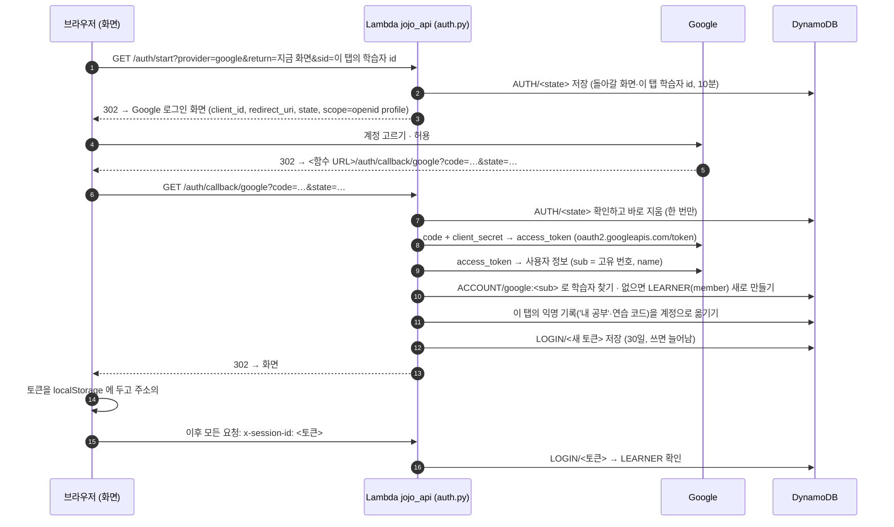

# git 웹사이트 열기
👉 https://torgeleli22-lang.github.io/teamProject_night_first/

# 코드 리딩 노트 — AI 가 짜 준 코드, 정말 읽을 수 있나요?

> 자세한 기준 문서: [`docs/PROJECT_BRIEF.md`](docs/PROJECT_BRIEF.md) (AI 원칙·DynamoDB·다음 할 일) · AI 사용 기준: [`docs/ai-generation-policy.md`](docs/ai-generation-policy.md) · 배포: [`docs/DEPLOY_LAMBDA.md`](docs/DEPLOY_LAMBDA.md)

## 1. 프로젝트 개념

**코드를 대신 짜 주는 AI 가 아니라, 코드를 읽고 흐름을 설명하도록 가르치는 AI** 예요.

AI 로 코드를 받아 쓰는 사람은 많지만, 그 코드가 **어떤 순서로 무엇을 하는지 설명하지 못하는** 경우가 많아요.
코드 리딩 노트는 공부 노트처럼 코드에 **형광펜**을 긋고 **포스트잇 메모**로 흐름을 적게 하고, AI 가 **빨간펜**으로 메모마다 첨삭해요.

| 표시 | 뜻 |
|---|---|
| ○ 정확 | 흐름과 결과를 정확히 설명했어요 |
| △ 부분 | 맞는 부분이 있지만 조건·순서·결과가 빠졌어요 |
| ✕ 오해 | 코드가 하는 일과 다르게 이해했어요 |
| ⬚ 누락 | ※ 꼭 설명할 곳에 메모가 없어요 (AI 없이 규칙으로 판정) |

첨삭은 정답을 바로 알려 주지 않고 **다시 볼 줄**을 짚어요. 모범 설명은 첨삭을 받은 뒤 직접 눌러야 보여요.

**내 공부** — 첨삭이 쌓이면 **어떤 흐름(개념)을 못 읽는지**(개념별 약점 지도 → '이 개념 집중 연습'), **언제 난이도를 올리고 내릴지**(난이도 추천), **내가 잘 쓴 설명**(내 설명 노트)을 보여 줘요. 모두 AI 없이 기록으로 계산해요.

**두 가지 모드**
- **연습 모드** — 언어(Python · JavaScript), 난이도(입문 · 초급 · 중급 · 고급)와 주제(랜덤 / 직접 적기)를 고르면 AI 가 읽기 연습용 코드와 ※ 꼭 설명할 곳을 만들어요. 고급은 100~200줄에 자료구조·알고리즘(최단 경로·동적 계획법 등)이 들어가요.
- **내 코드 점검** — 갖고 있는 Python 코드(파일 1개 또는 붙여넣기, 300줄까지)를 올리면 AI 가 난이도와 ※ 지점을 정해요. API 키·비밀번호 같은 값은 **보내기 전에 화면에서 가려요**.

## 2. 동작 방식 (사용자 흐름)

```
① 코드 받기            ② 메모하며 읽기                 ③ 빨간펜 첨삭                       ④ 더 깊게
연습: 난이도+주제  →   줄을 누르면 한 줄,           →  메모마다 ○△✕ + 다시 볼 줄      →  힌트 보고 다시 써 보기 (3번)
점검: 파일 올리기      누른 채 끌면 범위에 형광펜       빈 ※ 는 ⬚ 누락                     AI 튜터에게 묻기 (10번)
     (AI 가 코드·※)    포스트잇이 그 줄 옆에 붙음       왼쪽에 전체 코드                    모범 설명 보기
                       (범위 안에서 끌어 옮기기)
                       더 쉽게·더 어렵게 (5번)
```

| 단계 | 화면 | 서버(Lambda)에서 하는 일 | AI |
|---|---|---|---|
| 주제 고르기 | `/practice/` | 랜덤 주제 뽑기 · 직접 적은 주제 판정 (막연함 → 제안 3개, 너무 큼 → 좁히기, 부적절 → 거절) | 판정만 |
| 코드 받기 | `/practice/` | 언어(Python·JavaScript) 고르기 → ① AI 가 코드 + ※ 지점 생성 → ② 규칙 검사(Python 은 `ast` 로 문법·오타·금지 기능, JavaScript 는 괄호·따옴표 짝 같은 겉모양, 줄 수·※ 줄) → ③ 다른 AI 가 머릿속으로 실행해 검토(실행 오류·난이도·※ 모범 설명, 틀린 설명은 고침) → 걸리면 한 번 더 → 그래도 안 되면 예시 코드 | ○ ○ |
| 메모하며 읽기 | `/read/` | (메모는 브라우저에만 저장, '첨삭 받기' 때 보냄) · 더 쉽게/어렵게 = 새 코드 생성 | 다시 만들 때 |
| 첨삭 | `/result/` | ※ 와 겹치는 메모가 없으면 누락(규칙) → 메모마다 ○△✕·코멘트·모범 설명(AI) | ○ (메모가 있을 때) |
| 다시 써 보기 | `/result/` | 다시 쓴 설명 하나만 다시 채점 | ○ |
| AI 튜터 | `/result/` | 첨삭 항목 하나에 대해 묻고 답하기 (대화 저장) | ○ |
| 내 코드 점검 | `/check/` | 민감 정보 다시 가리기 · 함수 목록 · 훑어본 난이도(규칙) → '메모하러 가기'에서 AI 가 난이도·※ | 시작할 때 |
| 내 공부 | `/study/` | 첨삭 기록(로그인 안 함: 이 탭에서만 · 로그인: 1년)으로 난이도 추천 · 개념별 ○ 비율 · ○ 받은 설명 모음 · 최근 공부 | — |
| 관리자 | `/admin/` | AI 사용량·비용·실패 이유, AI 끄기, 관리자 코드 | — |

**AI 가 없어도 동작해요.** 관리자가 AI 를 끄거나, 월 예산($10)에 닿거나, 요청 한도를 넘으면 예시 코드 · 규칙 판정 · 규칙 첨삭으로 바뀌고 화면에 안내가 나와요.

## 3. 시스템 구성

```
브라우저 ──→ GitHub Pages (정적 화면, src/)
   │  JSON (x-session-id 헤더) — 주소는 하나
   └─→ Lambda jojo_api (Python, lambda/api/, 함수 URL) ──→ DynamoDB jojo_table (서울)
                                                       └─→ Bedrock Claude Haiku 4.5 (us-east-1)
```

- **화면**: Next.js 정적 내보내기(`output: "export"`). 서버 없이 GitHub Pages 에 올려요. main 에 병합하면 자동 배포.
- **서버**: Lambda **하나**. 입구 파일이 경로를 보고 기능 파일로 보내요. 콘솔 코드 탭에 **그대로 붙여넣는 읽을 수 있는 코드**(Python + boto3)라 zip·빌드가 없어요.
- **로그인 안 함**: 학습자 id 를 이 탭(sessionStorage)에만 둬요. **탭·브라우저를 닫으면 기록이 사라지고**, 서버의 기록도 하루 안에 자동 삭제돼요. 읽은 코드·첨삭은 만든 사람만 열 수 있어요.
- **로그인 (Google·GitHub, 선택)**: 오른쪽 위 **로그인** → 계정 고르기. 기록을 1년(연습 코드 30일) 남기고, 로그인 전에 이 탭에서 한 공부도 계정으로 옮겨요. 받는 정보는 계정 고유 번호와 이름뿐 (`auth.py`, 보관 기간은 `common.keep_seconds`). 설정: `docs/DEPLOY_LAMBDA.md` 5단계 · 흐름: 아래 3.1

### 3.1 로그인 흐름 (Google 기준, GitHub 도 같아요)



| 단계 | 파일 · 함수 | 지키는 것 |
|---|---|---|
| 1~3 시작 | `auth.py` → `start`, `safe_return` | 돌아갈 화면은 `ALLOWED_ORIGINS` 의 주소만 (다른 사이트로 토큰이 새지 않게) |
| 6~7 state 확인 | `auth.py` → `callback` | state 는 10분 안에 한 번만 — 가짜 콜백·다시 보내기 차단 |
| 8~9 사용자 확인 | `auth.py` → `fetch_profile` | client_secret 은 Lambda 환경 변수에만, 화면에 오지 않음. 이메일은 받지 않음 |
| 10 계정 찾기 | `auth.py` → `account_learner` | **이름이 아니라 고유 번호로 구분**: `ACCOUNT/google:<sub>`, `ACCOUNT/github:<id>`. 동명이인은 다른 계정, 이름을 바꿔도 같은 계정 |
| 11 기록 옮기기 | `auth.py` → `adopt_anonymous` | 옮긴 익명 id 는 `formerIds` 에 남겨 예전 코드도 열림. 올린 코드는 그대로 1일 |
| 12~14 토큰 | `auth.py` → `callback`, 화면 `src/lib/api.ts` → `takeLoginFromUrl` | 토큰은 무작위 uuid4 (시각 없음), 학습자 id 자체를 보내도 회원으로 받지 않음 |
| 15~16 이후 요청 | `common.py` → `get_learner`, `use_learner` | 로그아웃(`POST /auth/logout`)하면 토큰을 지워 다시 쓸 수 없음 |

---

## 4. 화면(프론트) 수정 가이드 — `src/`

### 4.1 구조

```
src/
├─ app/                                화면(페이지) — 폴더 이름이 주소
│  ├─ layout.tsx                       모든 화면의 틀: 글꼴(Google Fonts), 최대 너비 1440px, 위쪽 NoteHeader
│  ├─ globals.css                      공책 디자인 CSS (줄 공책·여백선·형광펜·버튼·도장·탭·코드 줄)
│  ├─ page.tsx                         01 첫 화면  /
│  ├─ practice/PracticeStart.tsx       02 연습 모드  /practice/
│  ├─ read/ReadNote.tsx                03 메모하며 읽기  /read/?id=
│  ├─ result/ResultNote.tsx            04 빨간펜 첨삭  /result/?id=
│  ├─ check/CheckCode.tsx              05 내 코드 점검  /check/
│  ├─ study/StudyNote.tsx              내 공부  /study/
│  └─ admin/AdminNote.tsx              관리자  /admin/
│     (각 폴더의 page.tsx 는 위 파일을 불러오기만 하는 껍데기 — 고칠 일 없음)
├─ components/                         여러 화면이 함께 쓰는 부품
│  ├─ ui.tsx                           Page · Crumb · Sticky · Stamp · LangTag · PenMark · Waiting · ErrorNote
│  ├─ MakingCode.tsx                   연습 코드를 기다리는 동안 ① 출제 ② 규칙 검사 ③ AI 검토 단계 안내
│  ├─ WideToggle.tsx                   '넓게 보기': 공책을 브라우저 너비만큼, 늘어난 너비는 코드 칸에 (오른쪽 메모·첨삭 칸 그대로) — 읽기·첨삭 화면
│  ├─ WideCode.tsx                     '크게 보기'(읽기 화면): FullScreen — 코드+메모 칸을 화면 가득, 메모 그대로 붙이기
│  ├─ NoteHeader.tsx                   맨 위 제목 + 로그인 상자(LoginBox) + 오른쪽 인덱스 탭(연습 모드 / 내 코드 점검 / 내 공부)
│  ├─ CodeView.tsx                     줄 번호·문법 색칠·형광펜·※·①② 가 있는 코드
│  ├─ MemoMargin.tsx                   코드 옆 포스트잇(끌어 옮기기) + DraftNote(메모 쓰는 칸)
│  ├─ RetryBox.tsx                     "힌트를 보고 다시 써 보기"
│  └─ TutorChat.tsx                    "AI 튜터에게 물어보기"
└─ lib/                                화면에 안 보이는 도구
   ├─ api.ts                           서버 부르기 (apiGet · apiPost · useApi), 세션 id
   ├─ api-types.ts                     서버 응답 모양 + 난이도 이름·설명, ○△✕ 이름, 더 쉽게 이유 문구
   ├─ highlight.ts                     Python 문법 색칠 규칙
   ├─ memos.ts                         메모 임시 저장(sessionStorage), 범위 겹침, ①② 번호
   └─ secrets.ts                       올린 코드 민감 정보 가리기 (lambda/api/inspect_code.py 와 같은 패턴)
```

### 4.2 화면별 파일 안 구성

| 화면 파일 | 안에 있는 부분 (함수) | 쓰는 부품 |
|---|---|---|
| `app/page.tsx` | 머리말 + 맛보기 코드, 두 모드 카드, 공부하는 순서 | Page · Sticky · CodeView · PenMark |
| `practice/PracticeStart.tsx` | `PracticeStart` 언어 탭(Python·JavaScript) · 난이도 카드 4개 · 주제 탭 · 코드 받기 / `TopicAdvice` 주제 제안 포스트잇 | Page · Crumb · Sticky · Waiting · MakingCode |
| `read/ReadNote.tsx` | `Reader` 본체(제목·도장·버튼·안내 줄·코드+메모) / `AdjustDialog` 더 쉽게·어렵게 창 / `useWide` 넓은 화면 판별 | CodeView · MemoMargin · DraftNote · Stamp |
| `result/ResultNote.tsx` | `ResultBody` 총평·○△✕ 개수·왼쪽 전체 코드 / `ItemRow` 메모별 첨삭 한 칸 | CodeView · PenMark · RetryBox · TutorChat |
| `check/CheckCode.tsx` | 파일 올리기/붙여넣기 탭 · 분홍 경고 포스트잇 · 함수 체크 목록 · 훑어본 난이도 도장 | Sticky · Stamp · Waiting |
| `study/StudyNote.tsx` | `LevelSection` 난이도 추천 · `ConceptSection`/`ConceptRow` 개념별 약점 지도 · `NotesSection` 내 설명 노트(개념 탭) · `RecentSection` 최근 공부 · `Bar` 형광펜 막대 | Sticky · Stamp · PenMark |
| `admin/AdminNote.tsx` | AI 스위치 · 비용 · `UsageTable` 작업별 사용량 · 최근 AI 호출 기록 · 날짜별 수 · 관리자 코드 | Sticky |

### 4.3 이걸 바꾸려면 → 이 파일

| 바꾸고 싶은 것 | 파일 · 위치 |
|---|---|
| **색** (책상·종이·형광펜·포스트잇·빨간펜·파란펜·코드 색) | `tailwind.config.ts` → `colors` (이름 하나를 바꾸면 모든 화면이 함께 바뀜) |
| **글꼴** (제목 고운바탕 · 손글씨 나눔펜체 · 코드 나눔고딕코딩) | `tailwind.config.ts` → `fontFamily` + `src/app/layout.tsx` 의 Google Fonts 링크 |
| 공책 줄 간격·여백선, 형광펜 모양, 버튼 그림자, 도장, 탭 | `src/app/globals.css` → `.page` `.marker` `.btn-ink` `.btn-line` `.btn-small` `.stamp` `.tab` |
| 화면 최대 너비 | `src/app/layout.tsx` → `max-w-[1440px]` |
| 위쪽 제목·인덱스 탭 | `src/components/NoteHeader.tsx` |
| 로그인 버튼·로그인 뒤 이름 표시 | `NoteHeader.tsx` → `LoginBox` · 토큰 보관은 `src/lib/api.ts` (`loginUrl`, `takeLoginFromUrl`, `logout`) |
| 포스트잇 기울기·테이프·색 종류 | `src/components/ui.tsx` → `Sticky`, `globals.css` → `.tape` |
| 빨간펜 ○△✕⬚ 그림 | `src/components/ui.tsx` → `PenMark` (문장 안에는 `<PenMark kind="correct" inline />`, 서버·AI 문장은 `<MarkText text={…} />` 가 ○△✕ 글자를 빨간펜 그림으로 바꿈 — **글자 ○△✕ 를 화면에 그대로 쓰지 않기**) |
| 코드 글자 크기·줄 높이 | `globals.css` → `.code-line` (**줄 높이를 바꾸면 `MemoMargin.tsx` 의 `ROW = 28` 도 같이** — 포스트잇 위치 계산) |
| 문법 색칠 규칙 | `src/lib/highlight.ts` + `CodeView.tsx` → `COLOR` |
| 형광펜 겹침 색, 고른 범위 색, 분홍 표시 | `CodeView.tsx` → `bg` 계산 줄 |
| 포스트잇 배치·끌어 옮기기·메모 쓰는 칸 | `src/components/MemoMargin.tsx` (`MemoMargin`, `DraftNote`) |
| 메모 수·글자 수 제한 (화면) | `read/ReadNote.tsx` → `MAX_MEMOS`, `MAX_MEMO_CHARS` (서버 `common.py` 와 같게) |
| 난이도 이름·설명 | `src/lib/api-types.ts` → `LEVEL_NAMES`, `LEVEL_DESCRIPTIONS` |
| ○△✕ 이름, 더 쉽게 이유 | `src/lib/api-types.ts` → `MARK_NAMES`, `ADJUST_REASONS` |
| 랜덤 주제 예시(손글씨 줄) | `practice/PracticeStart.tsx` → `EXAMPLES`, `ADVANCED_EXAMPLES` |
| 언어 탭 · 언어 설명 문구 | `practice/PracticeStart.tsx` → `LANGUAGES` · 제목 옆 언어 꼬리표는 `ui.tsx` → `LangTag` |
| 튜터 첫 질문 버튼 | `components/TutorChat.tsx` → `STARTERS` |
| 개념 이름 | `src/lib/api-types.ts` → `CONCEPT_NAMES` (서버 `common.CONCEPTS` 와 같게) |
| 내 공부 화면(추천 문구·막대 색·노트 모양) | `app/study/StudyNote.tsx` |
| 다시 써 보기 칸 문구 | `components/RetryBox.tsx` |
| 각 화면의 문구·배치 | 4.1 의 해당 화면 파일 |

스타일은 Tailwind 방식이라 태그의 `className` 에 바로 적혀 있어요. 예: `className="mt-4 text-sm text-pen-red"` = 위 여백 · 작은 글씨 · 빨간펜 색.
디자인 원칙: 공부 노트(줄 공책·여백선·형광펜·포스트잇·빨간펜·도장·인덱스 탭), **그라데이션·둥근 카드·이모지·파란 버튼은 쓰지 않아요.** 문구는 존댓말 "~해요".

### 4.4 서버 응답 모양을 바꿀 때
화면은 `lambda/` 를 직접 가져오지 않고 `src/lib/api.ts` 로만 불러요. Lambda 의 응답에 칸을 더하면 **`src/lib/api-types.ts` 의 타입도 같이** 고쳐요 (`npm run typecheck` 가 어긋난 곳을 알려 줘요).

---

## 5. Lambda(서버) 수정 가이드 — `lambda/api/`

### 5.1 파일과 경로

| 파일 | 하는 일 | 경로 | AI 작업 이름 |
|---|---|---|---|
| `lambda_function.py` | **입구**: 경로 → 기능 파일, 관리자 코드 확인, `GET /health` | `GET /health` | — |
| `common.py` | **공통 도구** (아래 5.2) | — | — |
| `topics.py` | 랜덤 주제 · 직접 적은 주제 판정 | `GET /topic/random`, `POST /topic/check` | `topic_check` |
| `practice.py` | 연습 코드(Python·JavaScript) + ※ 만들기 · 규칙 검사 · AI 검토 · 더 쉽게/어렵게 · 다시 읽기 | `POST /practice`, `POST /practice/adjust`, `GET /reading` | `code_generation`, `code_check` |
| `inspect_code.py` | 내 코드: 민감 정보 가리기 · 함수 찾기 · 난이도·※ | `POST /inspect`, `POST /inspect/start` | `code_inspection` |
| `review.py` | 빨간펜 첨삭 · 힌트 보고 다시 써 보기 | `POST /review`, `POST /review/retry` | `review`, `review_retry` |
| `tutor_chat.py` | 첨삭 항목별 AI 튜터 대화 | `POST /tutor` | `tutor_chat` |
| `study.py` | 내 공부: 첨삭 기록 저장 · 난이도 추천 · 개념별 약점 · 내 설명 노트 (AI 없음) | `GET /study` | — |
| `auth.py` | Google·GitHub 로그인 (OAuth, 라이브러리 없음) · 익명 기록을 계정으로 옮기기 | `GET /me`, `GET /auth/start`, `GET /auth/callback/google`·`github`, `POST /auth/logout` | — |
| `admin.py` | 관리자 (`x-admin-token` 필요): 사용량·비용·AI 끄기·관리자 코드 | `GET /admin/overview`, `POST /admin/ai`, `POST /admin/code` | — |
| `samples.py` | AI 를 못 쓸 때의 예시 코드 (Python 8개) · 랜덤 주제 목록 | — | — |
| `samples_js.py` | AI 를 못 쓸 때의 JavaScript 예시 코드 7개 (`samples.py` 가 합침) | — | — |
| `test_events.json` | 콘솔 테스트 이벤트 예시 (콘솔에 넣지 않아도 됨) | — | — |

모든 기능 파일은 맨 위에 **설명 블록**(경로·요청·응답 모양), 처리 함수에 **단계 번호 주석**(1. 2. 3. …), 맨 아래에 **도움 함수**가 있어요. 파일마다 `ROUTES = {"POST /경로": 함수}` 표가 있고, 입구가 이 표를 합쳐요.

### 5.2 `common.py` 안 (10개 구역)

| 구역 | 들어 있는 것 |
|---|---|
| 1. 설정 | 환경 변수(`TABLE_NAME`, `AI_MODE`, `MODEL_ID`, `ALLOWED_ORIGINS` …), **정한 값**: `MAX_CODE_LINES`(300) `REGEN_LIMIT`(5) `MAX_MEMOS`(20) `MAX_MEMO_CHARS`(500) `MAX_TUTOR_TURNS`(10) `MAX_RETRIES`(3) 보관 기간, `LEVELS`(난이도 4단계), `LIMITS`(요청 한도), `MONTHLY_BUDGET_USD`, `PRICE` |
| 2. AWS 연결 | DynamoDB 테이블, Bedrock 클라이언트(읽기 제한 120초) |
| 3. 요청·응답 | `read_request`(함수 URL 이벤트 → dict), `reply`, `cors_headers`, `run_route`(오류 처리), `field`(요청 값 확인) |
| 4. DynamoDB 도구 | `get_item` `put_item` `query_all` `update_item` `ttl_after` … |
| 5. 요청 수 제한 | `hit_limit`, `ai_allowed` |
| 6. 학습자(세션) | `get_learner`, `remember_topic` |
| 7. AI 호출 | **`ask_ai(task, system, prompt, schema, mock=…)`** — 모든 AI 호출은 이 함수로. 월 예산 확인, AI 끄기 스위치, 목업, 사용량(`USAGE`)·호출 기록(`AILOG`) |
| 8. 설정 값 | `get_meta`, `set_meta` (AI 스위치·관리자 코드 해시) |
| 9. 읽을 코드 | `CONCEPTS`·`guess_concept`(개념 꼬리표), `save_reading`, `load_reading`(내 코드만), `public_reading`(**화면으로 보내는 모양 — 모범 설명 빼고**), `clean_marks`, `latest_review`, `count_event` |
| 10. id 만들기 | `new_id()` — 시간순 UUID(버전 7): 앞 12글자가 만든 시각, 나머지 무작위. 학습자 id·코드 id 에 씀 (로그인 토큰은 전부 무작위 uuid4) |

### 5.3 이걸 바꾸려면 → 이 파일

| 바꾸고 싶은 것 | 파일 · 위치 |
|---|---|
| 업로드 줄 수, 다시 만들기·다시 쓰기·튜터 횟수, 메모 수, 보관 기간 | `common.py` 1번 설정 |
| 난이도 이름·설명 | `common.py` → `LEVELS` (화면 `api-types.ts` 도 같이) |
| 난이도별 코드 길이·문법·※ 수·AI 답 길이 | `practice.py` → `LEVEL_GUIDE`(언어별), `MIN_LINES`·`MAX_LINES`, `MARK_COUNT`, `OUTPUT_TOKENS` |
| **AI 지시문(프롬프트)** | 각 파일의 `SYSTEM_PROMPT` — 코드 만들기 `practice.py` · 주제 판정 `topics.py` · 내 코드 분석 `inspect_code.py` · 첨삭 `review.py`(`SYSTEM_PROMPT`, 다시 쓰기 `RETRY_PROMPT`) · 튜터 `tutor_chat.py` |
| AI 답의 모양(JSON 칸) | 각 파일의 `SCHEMA` (바꾸면 그 답을 쓰는 코드와 목업도 같이) |
| 만든 코드 검사 기준 | `practice.py` → `check_generated` (Python `py_ast_problems`, JavaScript `js_shape_problems`) · AI 검토 `ai_check_code`, 지시문 `CHECK_PROMPT` |
| AI 없을 때의 판정·첨삭·튜터 답 | `topics.rule_check`, `inspect_code.rule_analysis`, `review.rule_review`·`rule_retry`, `tutor_chat.rule_answer` |
| 주제 판정 금지어·막연한 말·큰 말 | `topics.py` → `BAD_WORDS`, `VAGUE_WORDS`, `BIG_WORDS` |
| 가리는 민감 정보 모양 | `inspect_code.py` → `SECRET_PATTERNS` (**화면 `src/lib/secrets.ts` 도 같이**) |
| 예시 코드·랜덤 주제 | `samples.py` → `SAMPLES`, `TOPIC_POOL`, `ADVANCED_TOPIC_POOL` · JavaScript 는 `samples_js.py` (고치면 `npm run verify`) |
| 언어 추가·언어별 출제 규칙 | `common.py` → `LANGUAGES` · `practice.py` → `CODE_RULES`, `LEVEL_GUIDE`, JavaScript 검사 `js_shape_problems` · 화면 `src/lib/highlight.ts`, `api-types.ts` → `Language` |
| 요청 한도·월 예산 | `common.py` → `LIMITS`, `MONTHLY_BUDGET_USD` 또는 Lambda 환경 변수 |
| 관리자 화면의 작업 이름·실패 이유 문구 | `admin.py` → `TASKS`, `ERROR_REASONS` |
| 개념 종류·이름, 개념 추정 규칙 | `common.py` → `CONCEPTS`, `_CONCEPT_RULES`, `guess_concept` (화면 `CONCEPT_NAMES` 도 같이) |
| 난이도 추천 기준(80%·40%·최근 5개·3개 이상), 약점 기준 | `study.py` → `LEVEL_UP`, `LEVEL_DOWN`, `RECENT_PER_LEVEL`, `MIN_FOR_LEVEL`, `MIN_FOR_WEAK` |
| 보관 기간 (로그인 안 함: 학습자 12시간·기록 1일 / 로그인: 1년·연습 코드 30일 / 올린 코드 1일) | `common.py` → `ANON_HOURS`, `ANON_READING_HOURS`, `MEMBER_DAYS`, `READING_KEEP_DAYS`, `UPLOAD_KEEP_DAYS`, `keep_seconds` |
| 새 기능 경로 추가 | 기능 파일을 새로 만들고 `ROUTES` 를 둔 뒤 `lambda_function.py` 의 `for feature in (…)` 에 추가 (함수를 늘리지 않음) |

### 5.4 DynamoDB 항목 (테이블 `jojo_table`, pk / sk)

| pk | sk | 내용 |
|---|---|---|
| `LEARNER` | 학습자 id | 고른 난이도, 최근 주제 10개, (로그인) member·이름·제공자 |
| `ACCOUNT` · `LOGIN` · `AUTH` | 계정 / 토큰 / state | 계정 → 학습자, 로그인 토큰(30일), 로그인 시작 기록(10분) |
| `READ#<id>` | `CODE` | 읽을 코드: 코드·난이도·주제·※ 지점(모범 설명 포함)·만든 사람 |
| `READ#<id>` | `REVIEW#<시각>` | 첨삭 결과 |
| `READ#<id>` | `RETRY#<첨삭 시각>#<항목>` | 다시 써 본 기록 |
| `READ#<id>` | `CHAT#<첨삭 시각>#<항목>` | 튜터 대화 |
| `STUDY#<학습자>` | `R#<읽은 코드 id>` | 내 공부 기록: 개념·처음/가장 좋은 판정·내 설명 (로그인 안 함 1일 · 로그인 1년) |
| `STATS` | `DAY#날짜` | 하루 사용 수 |
| `USAGE` · `AILOG` | 월·작업·모델 / 시각 | AI 토큰·비용, AI 호출 기록 |
| `META` | `ai_switch` · `admin_code_hash` | AI 스위치, 관리자 코드 |

항목 모양을 바꾸면 그 항목을 읽는 기능 파일 모두와 `src/lib/api-types.ts` 를 함께 고치고 `npm run smoke` 로 확인해요. 자세한 표: `docs/PROJECT_BRIEF.md` §9.2

### 5.5 콘솔에 반영하기
1. GitHub 에서 바뀐 파일을 열고 **Raw** → 전체 복사 → 콘솔 `jojo_api_py` 코드 탭의 같은 이름 파일에 **전체를 바꿔** 붙여넣기 → **Deploy**
2. 테스트 이벤트 `{"path": "/health", "method": "GET"}` → `"ok": true`
3. 여러 파일이 서로 쓰는 함수를 옮겼다면 그 파일들을 **함께** 바꿔요 (일부만 바꾸면 `ImportError`)
4. 설정: Python 3.13 이상 · arm64 · 512MB · 제한 시간 **5분** · 실행 역할 `SafeRole-sgu-202688` · 환경 변수는 `docs/DEPLOY_LAMBDA.md`

---

## 6. 내 컴퓨터에서 실행·확인

```bash
npm install
python3 -m pip install boto3   # Python 3.10 이상
npm run api                    # 터미널 1: Lambda  http://localhost:8787 (DynamoDB 흉내 서버 + 목업 AI, 비용 없음)
npm run dev                    # 터미널 2: 화면 http://localhost:3000  (관리자: /admin)
```

| 명령 | 하는 일 |
|---|---|
| `npm run typecheck` | 타입 검사 (화면 ↔ 응답 모양) |
| `npm test` | 단위 테스트 (TS: 민감 정보·문법 색칠·경계 / Python: 예시 코드·주제·검사·첨삭·튜터·관리자) |
| `npm run verify` | 예시 코드를 실제로 실행하고 ※ 줄 범위 확인 |
| `npm run build` | 정적 화면 빌드 (`out/`) |
| `npm run smoke` | Lambda 전체 흐름 점검 (주제 → 코드 → 첨삭 → 다시 쓰기 → 튜터 → 점검 → 관리자) |

화면만 고쳤으면 `typecheck` · `build`, Lambda 를 고쳤으면 `test` · `verify` · `smoke` 까지 통과시킨 뒤 main 에 병합하세요. 화면은 병합하면 자동 배포되고, Lambda 는 5.5 처럼 콘솔에 붙여넣어요.

## 7. 디렉터리 한눈에

```
src/                화면 (4장)
lambda/api/         서버 Lambda 파일 (5장) · lambda/tests/ Python 테스트
scripts/            local-api.mjs + local_lambdas.py(로컬 실행) · smoke.mjs · verify_samples.py
tests/              TypeScript 테스트
docs/               PROJECT_BRIEF.md · ai-generation-policy.md · DEPLOY_LAMBDA.md
.github/workflows/  ci.yml(자동 검사) · pages.yml(화면 배포)
```

## 다음 단계
- 내 코드 점검에 JavaScript · Java
- AI 가 만든 코드의 실제 실행 확인
