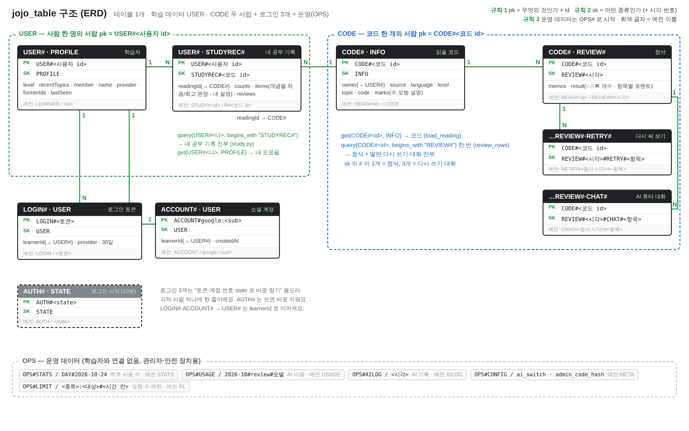
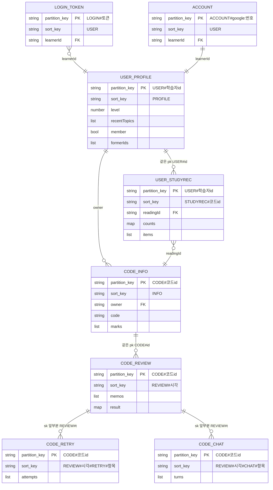

# DynamoDB 구조 — `jojo_table` 항목과 관계

`jojo_table` 의 항목 종류와 서로 이어지는 방식을 한 번에 볼 수 있게 정리했어요.
- 코드로 따라 읽기: `docs/CODE_TOUR.md`
- 역할별 사용·API 요청: `docs/DATA_AND_API_GUIDE.md`
- 필드 요약: `docs/PROJECT_BRIEF.md` §9.2

> 그림 원본은 `docs/images/jojo_table_erd.png` 예요. 회색 글자는 키 이름을 정리하기 전의 예전 이름이에요 (예전 데이터는 관리자 화면 **예전 데이터 옮기기**로 옮겨요).

---

## 1. 한눈에 보기

- **테이블은 1개** (`jojo_table`). 키는 `pk`(파티션 키, 문자열) + `sk`(정렬 키, 문자열)이고, 자동 삭제 시각은 `jojo_ttl`(유닉스 초)이에요.
- 관계형 DB 의 "테이블 여러 개"를 **pk 앞부분(접두어)**으로 나눠요. 그림의 상자 하나가 "항목 종류" 하나예요.
- 서로 다른 종류는 **외래 키 대신 필드 값**(`owner`, `readingId`, `learnerId`)으로 이어져요. DynamoDB 가 자동으로 지켜 주지 않으므로, Lambda 코드가 직접 따라가서 읽어요.

| 덩어리 | pk | 담는 것 | 그림 색 |
|---|---|---|---|
| **USER** | `USER#<학습자 id>` | 학습자 한 명의 프로필 + 내 공부 기록 | 초록 점선 |
| **CODE** | `CODE#<코드 id>` | 읽을 코드 한 개 + 첨삭 + 다시 쓰기 + 튜터 대화 | 파랑 점선 |
| **로그인** | `LOGIN#<토큰>` · `ACCOUNT#<제공자>:<번호>` · `AUTH#<state>` | 토큰·계정·로그인 시작 기록 (각각 한 줄) | 검정 상자 |
| **OPS** | `OPS#STATS` · `OPS#USAGE` · `OPS#AILOG` · `OPS#CONFIG` · `OPS#LIMIT` | 운영·관리자·안전 장치 (학습자와 연결 없음) | 회색 점선 |

### 키 이름 규칙 3가지

| 규칙 | 뜻 | 예 |
|---|---|---|
| 1. **pk = 무엇의 것인지 + id** | 한 사람·한 코드의 데이터가 한 서랍(pk)에 모여요 → `query` 한 번으로 꺼낼 수 있어요 | `USER#019a…`, `CODE#3c90…` |
| 2. **sk = 종류 (+ 시각·번호)** | 서랍 안에서 무슨 칸인지. 시각을 넣으면 sk 정렬 = 시간 순서 | `PROFILE`, `STUDYREC#3c90…`, `REVIEW#1792592284764123` |
| 3. **운영 데이터는 `OPS#`** | 학습 데이터와 섞이지 않게 | `OPS#STATS`, `OPS#CONFIG` |

이름은 `lambda/api/common.py` 4번 구역의 함수로만 만들어요. 다른 파일에서 `"USER#"` 같은 글자를 직접 쓰지 않아요.

| 함수·상수 | 만드는 값 |
|---|---|
| `user_pk(id)` | `USER#<id>` |
| `studyrec_sk(코드 id)` | `STUDYREC#<코드 id>` |
| `code_pk(id)` | `CODE#<id>` |
| `login_pk(토큰)` | `LOGIN#<토큰>` |
| `account_pk("google:번호")` | `ACCOUNT#google:<번호>` |
| `auth_pk(state)` | `AUTH#<state>` |
| `review_key(첨삭, "RETRY"/"CHAT", 번호)` | `REVIEW#<시각>#RETRY#002` |
| `PROFILE` · `INFO` · `USER` · `STATE` | 고정 sk |
| `OPS_STATS` · `OPS_USAGE` · `OPS_AILOG` · `OPS_CONFIG` · `OPS_LIMIT` | 운영 pk |

---

## 2. 항목 종류 (엔터티) 표

### 2-1. USER 서랍 — `pk = USER#<학습자 id>`

| sk | 이름 | 주요 필드 | 만드는 곳 | 자동 삭제 |
|---|---|---|---|---|
| `PROFILE` | 학습자 | `level`, `recentTopics`(최근 10개), `createdAt`, `lastSeen`, 로그인 학습자만 `member`·`name`·`provider`·`formerIds` | `common.get_learner`(비회원), `auth.account_learner`(회원) | 비회원: 마지막 사용 12시간 뒤 · 회원: 1년 |
| `STUDYREC#<코드 id>` | 내 공부 기록 (코드 1개당 1줄) | `readingId`, `source`, `language`, `level`, `title`, `counts`, `items[{concept, first, best, memo, bestText …}]`, `reviews`, `reviewedAt` | `study.record_review`(첨삭 때), `study.record_retry`(다시 써서 나아질 때) | 비회원: 1일 · 회원: 1년 |

### 2-2. CODE 서랍 — `pk = CODE#<코드 id>`

| sk | 이름 | 주요 필드 | 만드는 곳 | 자동 삭제 |
|---|---|---|---|---|
| `INFO` | 읽을 코드 | `id`, `owner`, `source`(practice·inspect), `language`, `level`, `topic`, `title`, `code`, `marks[{id, start, end, why, explanation, keywords}]`, `rootId`, `regenCount`, `origin` | `common.save_reading` | 비회원: 1일 · 회원: 30일 · 올린 코드: 늘 1일 |
| `REVIEW#<시각>` | 첨삭 (할 때마다 새 줄) | `memos[{start, end, text}]`, `result`(○△✕ 개수·항목별 코멘트) | `review.review` | 코드와 같은 날 |
| `REVIEW#<첨삭 시각>#RETRY#<항목>` | 힌트 보고 다시 써 보기 | `attempts[{text, mark, comment, lookAt, byAi, at}]` | `review.retry` | 코드와 같은 날 |
| `REVIEW#<첨삭 시각>#CHAT#<항목>` | AI 튜터 대화 | `turns[{role, text, lookAt, at}]` | `tutor_chat.ask_tutor` | 코드와 같은 날 |

> `marks` 의 `explanation`·`keywords`(모범 설명)는 DB 에만 있어요. 화면으로는 `public_reading` 이 뺀 모양만 보내고, 모범 설명은 첨삭 결과에만 나와요.

### 2-3. 로그인 — 각각 한 줄짜리 서랍

| pk | sk | 이름 | 주요 필드 | 자동 삭제 |
|---|---|---|---|---|
| `LOGIN#<토큰>` | `USER` | 로그인 토큰 | `learnerId`, `provider`, `createdAt` | 30일 (쓰면 늘어남, 로그아웃하면 삭제) |
| `ACCOUNT#<제공자>:<고유 번호>` | `USER` | 소셜 계정 → 학습자 | `learnerId`, `createdAt` | 없음 |
| `AUTH#<state>` | `STATE` | 로그인 시작 기록 | `provider`, `returnTo`, `anonSid` | 10분 (콜백에서 한 번 쓰고 바로 삭제) |

### 2-4. OPS — 운영 데이터

| pk | sk | 이름 | 주요 필드 | 자동 삭제 |
|---|---|---|---|---|
| `OPS#STATS` | `DAY#<yyyy-mm-dd>` | 하루 사용 수 | `practices`, `adjusts`, `topicChecks`, `inspections`, `reviews`, `retries`, `tutorChats` | 90일 |
| `OPS#USAGE` | `<연-월>#<작업>#<모델>` | AI 사용량·비용 | `calls`, `input`, `output`, `cacheRead`, `failures`, `lastError` | 없음 |
| `OPS#AILOG` | `<시각>` | AI 호출 기록 | `task`, `model`, `ok`, `stage`, `input`, `output`, `ms`, `error` | 14일 |
| `OPS#CONFIG` | `ai_switch` · `admin_code_hash` | 설정 | `value` | 없음 |
| `OPS#LIMIT` | `<종류>:<대상>#<시간 칸>` | 요청 수 제한 카운터 | `n` | 시간 칸이 지나면 |

---

## 3. 관계

> Mermaid 그림에서 `partition_key` = 테이블의 `pk`, `sort_key` = `sk` 예요 (`pk` 가 Mermaid 예약어라 이름만 바꿔 적었어요). `FK` 는 다른 항목을 가리키는 필드라는 표시일 뿐, DynamoDB 가 검사하지는 않아요.

| 관계 | 개수 | 무엇으로 이어지나 | 코드가 따라가는 방법 |
|---|---|---|---|
| 학습자 → 내 공부 기록 | 1 : N | **같은 pk** `USER#<id>` | `query_all(user_pk(id), prefix="STUDYREC#")` (`study.py`) |
| 학습자 → 읽을 코드 | 1 : N | `CODE#…/INFO` 의 `owner` = 학습자 id | `load_reading` 이 `owner` 가 나(또는 `formerIds`)인지 확인 |
| 내 공부 기록 → 읽을 코드 | N : 1 (코드 1개당 기록 1줄) | `readingId` (= sk 의 코드 id) | 로그인할 때 `adopt_anonymous` 가 `readingId` 로 코드 서랍을 찾아 `owner` 를 바꿈 |
| 읽을 코드 → 첨삭 | 1 : N | **같은 pk** `CODE#<id>` | `review_rows` = `query_all(code_pk(id), prefix="REVIEW#")` |
| 첨삭 → 다시 쓰기·튜터 대화 | 1 : N | **sk 앞부분**이 그 첨삭의 sk (`REVIEW#<t>#…`) | `review_children(첨삭, "RETRY"/"CHAT", rows)` — 위와 같은 query 결과에서 골라냄 |
| 로그인 토큰 → 학습자 | N : 1 (기기마다 토큰) | `learnerId` | `get_learner` 2번 단계: `LOGIN#<토큰>` → `USER#<learnerId>/PROFILE` |
| 소셜 계정 → 학습자 | 1 : 1 | `learnerId` | `account_learner`: `ACCOUNT#google:<번호>` → `USER#<learnerId>` |
| 로그인 시작 → 비회원 | 1 : 0..1 | `anonSid` | 콜백에서 `adopt_anonymous(anonSid, 회원 id)` 로 비회원 기록을 회원에게 옮김 |
| OPS | — | 학습자와 연결 없음 | 관리자 화면·안전 장치만 읽음 |

**첨삭을 구분하는 법**: `CODE#<id>` 서랍에서 `REVIEW#` 로 시작하는 sk 중
- `#` 이 1개 (`REVIEW#1792…`) → 첨삭 자체 (`latest_review` 는 이 중 마지막 = 최신)
- `#` 이 3개 (`REVIEW#1792…#RETRY#002`) → 그 첨삭의 2번 항목 다시 쓰기
- sk 가 글자 순으로 정렬되므로, 첨삭 바로 뒤에 딸린 기록들이 붙어서 저장돼요.

---

## 4. 화면 동작 → 읽고 쓰는 항목

| 화면 동작 | 경로 | 읽기 | 쓰기 |
|---|---|---|---|
| 처음 방문 | 모든 요청 | `USER#<id>/PROFILE` 또는 `LOGIN#<토큰>/USER` | 없으면 `USER#<새 id>/PROFILE` 생성 |
| 연습 코드 받기 | `POST /practice` | `PROFILE` | `CODE#<새 id>/INFO`, `OPS#STATS` |
| 더 쉽게·어렵게 | `POST /practice/adjust` | `CODE#<id>/INFO` | `CODE#<새 id>/INFO` (`rootId` 로 횟수 세기) |
| 코드 다시 열기 | `GET /reading` | `CODE#<id>/INFO` + `query(CODE#<id>, "REVIEW#")` 한 번 | — |
| 첨삭 받기 | `POST /review` | `CODE#<id>/INFO` | `CODE#<id>/REVIEW#<시각>`, `USER#<id>/STUDYREC#<코드 id>`, `OPS#STATS` |
| 다시 써 보기 | `POST /review/retry` | `query(CODE#<id>, "REVIEW#")` | `…/REVIEW#<t>#RETRY#<항목>`, 나아지면 `STUDYREC#` 갱신 |
| 튜터에게 질문 | `POST /tutor` | `query(CODE#<id>, "REVIEW#")` | `…/REVIEW#<t>#CHAT#<항목>` |
| 내 공부 | `GET /study` | `query(USER#<id>, "STUDYREC#")` | — |
| Google 로그인 | `/auth/start` → `/auth/callback/google` | `AUTH#`, `ACCOUNT#` | `AUTH#`(만들고 지움), `ACCOUNT#`, `USER#/PROFILE`, `LOGIN#`, 비회원 기록 이동 |
| 로그아웃 | `POST /auth/logout` | — | `LOGIN#<토큰>` 삭제 |
| AI 호출 (모든 AI 작업) | `ask_ai` | `OPS#CONFIG/ai_switch`, `OPS#USAGE` | `OPS#USAGE`, `OPS#AILOG`, `OPS#LIMIT` |
| 관리자 화면 | `/admin/...` | `OPS#USAGE`, `OPS#AILOG`, `OPS#STATS`, `OPS#CONFIG` | `OPS#CONFIG` (AI 스위치·관리자 코드) |
| 예전 데이터 옮기기 | `POST /admin/migrate` | 테이블 전체 scan | 새 이름으로 쓰고 예전 이름 삭제 |

---

## 5. 예전 이름 → 새 이름

| 예전 (pk / sk) | 새 (pk / sk) |
|---|---|
| `LEARNER` / `<id>` | `USER#<id>` / `PROFILE` |
| `STUDY#<id>` / `R#<코드 id>` | `USER#<id>` / `STUDYREC#<코드 id>` |
| `READ#<코드 id>` / `CODE` | `CODE#<코드 id>` / `INFO` |
| `READ#<코드 id>` / `REVIEW#<t>` | `CODE#<코드 id>` / `REVIEW#<t>` |
| `READ#<코드 id>` / `RETRY#<t>#<n>` | `CODE#<코드 id>` / `REVIEW#<t>#RETRY#<n>` |
| `READ#<코드 id>` / `CHAT#<t>#<n>` | `CODE#<코드 id>` / `REVIEW#<t>#CHAT#<n>` |
| `LOGIN` / `<토큰>` | `LOGIN#<토큰>` / `USER` |
| `ACCOUNT` / `<제공자>:<번호>` | `ACCOUNT#<제공자>:<번호>` / `USER` |
| `AUTH` / `<state>` | `AUTH#<state>` / `STATE` |
| `STATS` · `USAGE` · `AILOG` · `META` / 그대로 | `OPS#STATS` · `OPS#USAGE` · `OPS#AILOG` · `OPS#CONFIG` / 그대로 |
| `RL` / … | 옮기지 않고 삭제 (몇 분짜리 카운터, 새 이름 `OPS#LIMIT`) |

바꾸는 규칙은 `lambda/api/admin.py` 의 `new_key`, 옮기는 순서(새 이름으로 쓰기 → 예전 것 지우기)는 `migrate` 에 있어요. 여러 번 실행해도 결과가 같아요.

---

## 6. 항목 모양을 바꿀 때

1. 이름은 `common.py` 4번 구역의 함수·상수만 고쳐요.
2. 그 항목을 읽는 기능 파일 모두와 `src/lib/api-types.ts` 를 함께 고쳐요.
3. 이미 저장된 데이터가 있으면 `admin.py` `new_key` 에 옮기는 규칙을 더해요.
4. `npm test`, `npm run smoke` 로 확인하고, 이 문서와 그림(`docs/images/jojo_table_erd.png`)도 함께 고쳐요.
